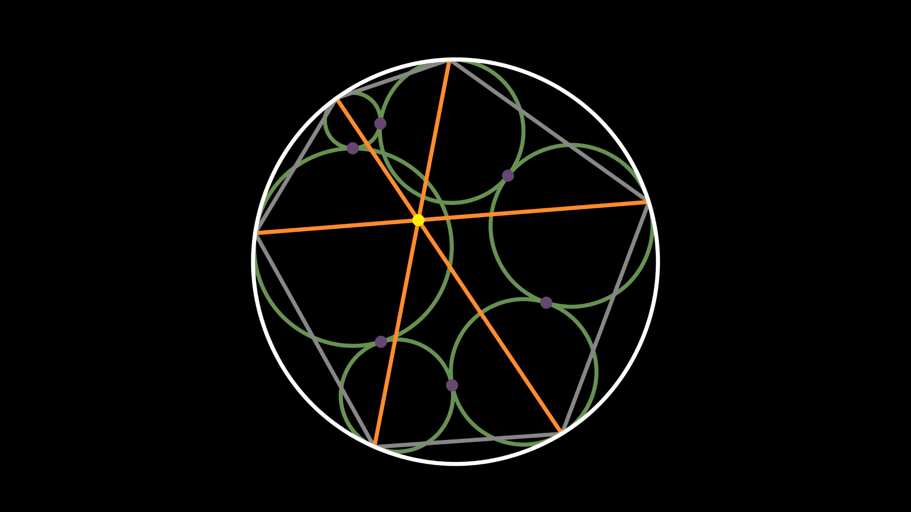
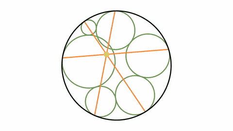

# The Seven Circle Theorem

This repository contains the source code for a video about the proof of the Seven Circle Theorem by [Drach and Schwartz](https://arxiv.org/pdf/1911.00161.pdf).
The video was created using [manim](https://github.com/ManimCommunity/manim).

The video is uploaded to YouTube. The video is available in [English](https://youtu.be/m9v0h2ibYpo) and in [German](https://youtu.be/flR3e5Cc2G4).

## Theorem

For every chain $H_1, \ldots, H_6$ of consequently touching circles inscribed in and touching the unit circle, the three main diagonals of the hexagon comprised of the points at which the chain touches the unit circle, intersect at a common point.

[](https://youtu.be/m9v0h2ibYpo)

<p align="center">
  <picture>
    <source media="(prefers-color-scheme: dark)" srcset="assets/circles-loop-dark.gif">
    
  </picture>
</p>

## Acknowledgments

[`tessellation_klein.png`](tessellation_klein.png) and [`tessellation_poincare.png`](tessellation_poincare.png) are made using the [Hyperbolic Tessellation program](https://dmitrybrant.com/2007/01/24/hyperbolic-tessellations) by [Dmirty Brant](https://github.com/dbrant).

## Development

### Prerequisites

For development, you need to install [pixi](https://pixi.sh) as well as TeXLive.

On macOS, you can do this via [Homebrew](https://brew.sh):

```bash
brew install pixi
brew install mactex-no-gui
```

On Ubuntu, you can do this as follows:

```bash
sudo apt install texlive-full
curl -fsSL https://pixi.sh/install.sh | bash
```

On Windows, you can use the [TeX Live installer](https://www.tug.org/texlive/windows.html#install)
and install pixi as follows:

```bash
winget install prefix-dev.pixi
```

### Rendering

To render the videos, run

```bash
pixi run 4k-render-all
```

### Circles loop

[`circles_loop.py`](circles_loop.py) contains `Scene1` of the introduction (the chain of circles moving around)
with configurable colors, rendered as a seamless loop in a dark and a light variant.
To render both variants and convert them to the GIFs shown above, run

```bash
pixi run render-loop
```
